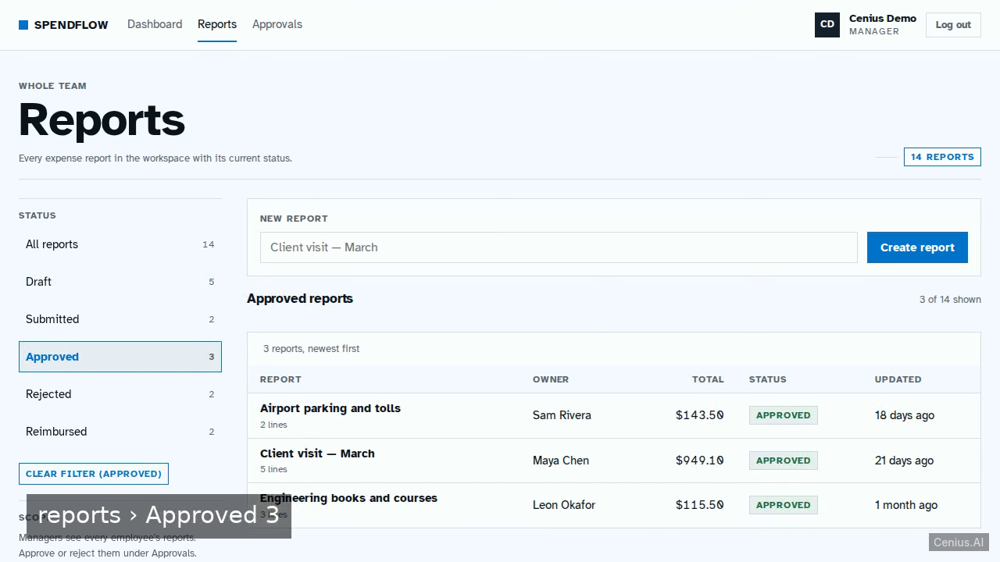
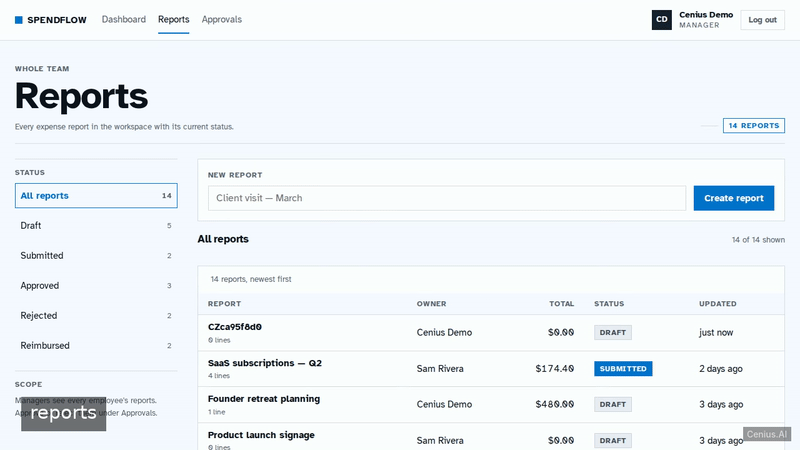
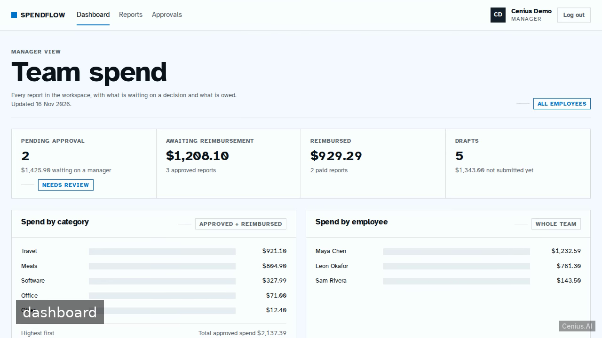
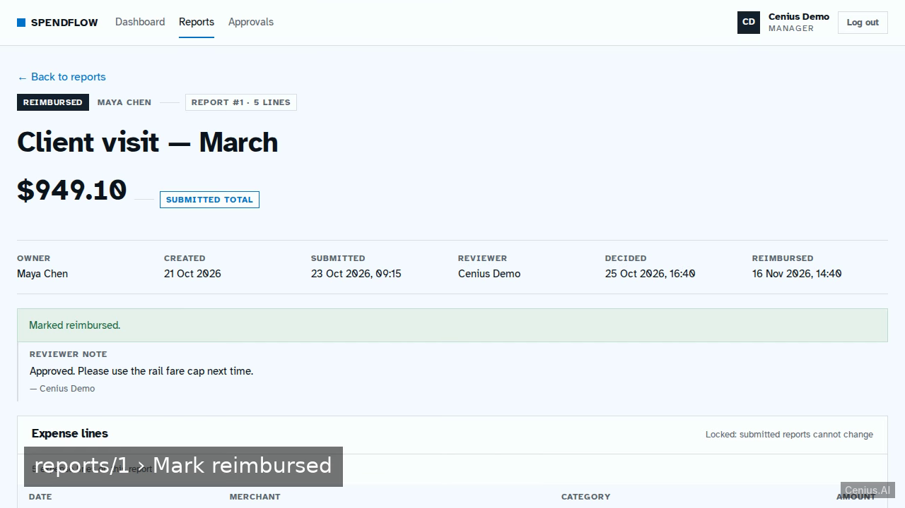

# Spendflow Expense Reports — Vite expense personal finance tracker reference implementation

Spendflow is an open-source, self-hostable expense report tool for startups: employees sign in, build a report from individual expense lines (receipt amount, category, date, merchant), submit it, and a manager approve…. That's **Spendflow Expense Reports** — a Apache-2.0-licensed, open-source expense personal finance tracker in Vite you can self-host and modify freely. Fork Spendflow Expense Reports, run it, or [remix it on cenius.ai](https://cenius.ai/marketplace/p/spendflow-expense-reports?ref=gh&utm_campaign=spendflow-expense-reports-vite) for a custom Spendflow Expense Reports build with full rebrand rights.


[](LICENSE)  [](https://cenius.ai)

[](https://cenius.ai/marketplace/p/spendflow-expense-reports?ref=gh&utm_campaign=spendflow-expense-reports-vite)

> **▶ [Open & edit in cenius.ai](https://cenius.ai/marketplace/p/spendflow-expense-reports?ref=gh&utm_campaign=spendflow-expense-reports-vite)** — one click to an editable workspace: describe changes in plain English, get an instant preview, one-click deploy and host. Modifications made on the platform come with full rebrand & relicense rights.

_Local clone? See [Quick start](#quick-start) below. cenius.ai is the zero-setup path._

## Demo





▶ **[Watch the full demo video](https://cenius.ai/marketplace/p/spendflow-expense-reports?ref=gh&utm_campaign=spendflow-expense-reports-vite)** — the complete walkthrough, playing on the project's cenius.ai page · [MP4 file](.github/media/demo.mp4)

## Screenshots

  

## Features

- Email + password sign-in with JWT session
- Expense claim line items with receipt amount, category and date
- Report submission
- Manager approval and rejection with note
- Reimbursement status tracking
- Spend by category and by employee charts
- Role-aware dashboard summary
- Seeded demo workspace

## Architecture

Everything runs out of the box: a Vite codebase (91 files). The setup script (`install.sh`) installs runtime dependencies and loads a starter dataset so the app is immediately usable. Top-level layout: `backend/`, `frontend/`. Full setup details: [`INSTALL.md`](INSTALL.md).

## Quick start

```bash
./install.sh   # installs dependencies + seeds demo data
```

See [`INSTALL.md`](INSTALL.md) for full setup and usage instructions.

## Usage guide

A walkthrough of the real screens. Sign in at <http://localhost:5173/login> with
`maya@spendflow.dev` / `cenius` (employee) or `cenius@cenius.ai` / `cenius`
(manager).

### 1. Sign in

The sign-in screen has the product story on the left and the form on the right.
Email and password are validated per field, the password has a show/hide toggle,
and the demo accounts can be filled with one click. Wrong credentials always return
the same message — "Invalid email or password" — so accounts cannot be enumerated.
The JWT is stored in `localStorage`, so a page refresh keeps you signed in. The
header shows your name, your role and a **Log out** button.

### 2. Dashboard (`/dashboard`, also `/`)

- **Summary cards**: pending approval (count + money waiting), approved awaiting
  reimbursement, reimbursed to date, and drafts not yet submitted.
- **Spend by category** and **Spend by employee**: horizontal bars sorted highest
  to lowest with a dollar label on every bar. Only approved and reimbursed reports
  count, so pipeline noise never inflates the numbers. With no approved spend the
  panels show a friendly prompt instead of an empty chart.
- **Recent activity**: the five most recently updated reports with status badges.

Managers see the whole team; employees see only their own figures.

### 3. Reports (`/reports`)

_Full guide: [`USAGE.md`](USAGE.md)_

## FAQ

### How do I get Spendflow Expense Reports running locally?

`git clone` + `./install.sh` gets you a running instance — the install script provisions dependencies and demo data. Full steps live in [`INSTALL.md`](INSTALL.md); nothing external is needed to try it.

### What technologies are in Spendflow Expense Reports's stack?

The app is built with Vite. What you see in this repo is the full production source, demo data included. Highlights include spend by category and by employee charts.

### How do I make Spendflow Expense Reports my own brand?

Yes. You can edit the source directly under the MIT license, or [remix it on cenius.ai](https://cenius.ai/marketplace/p/spendflow-expense-reports?ref=gh&utm_campaign=spendflow-expense-reports-vite) — the platform route grants full rebrand and relicense rights over your derivative.

### Does the Spendflow Expense Reports license allow commercial use?

Yes — it ships under the Apache-2.0 license, which permits commercial use, modification and redistribution. The full text is in [LICENSE](LICENSE).

### Can I change Spendflow Expense Reports without writing code?

Yes — [load it on cenius.ai](https://cenius.ai/marketplace/p/spendflow-expense-reports?ref=gh&utm_campaign=spendflow-expense-reports-vite), describe the change in plain English, and you get back a fresh build with your modification applied.

## License & rebranding

Released under the [Apache License 2.0](LICENSE) (© 2026 Cenius AI) — free for personal and commercial use. The Cenius name/logo are trademarks (see NOTICE).

**Need a customized version?** [Remix this app on cenius.ai](https://cenius.ai/marketplace/p/spendflow-expense-reports?ref=gh&utm_campaign=spendflow-expense-reports-vite) — modifications made on the platform come with **full rebrand & relicense rights** over your derivative.

## Built with cenius.ai

This entire application — code, design, seeded demo data — was generated on **[cenius.ai](https://cenius.ai)** from a plain-English description.

- 🚀 [Build your own app on cenius.ai](https://cenius.ai)
- 🎛️ [Remix Spendflow Expense Reports on the marketplace](https://cenius.ai/marketplace/p/spendflow-expense-reports?ref=gh&utm_campaign=spendflow-expense-reports-vite) — open it in a workspace, prompt for changes, and ship your own version.

More open-source apps: [the Cenius-ai catalog](https://github.com/Cenius-ai) · [showcase index](https://github.com/Cenius-ai/showcase)
